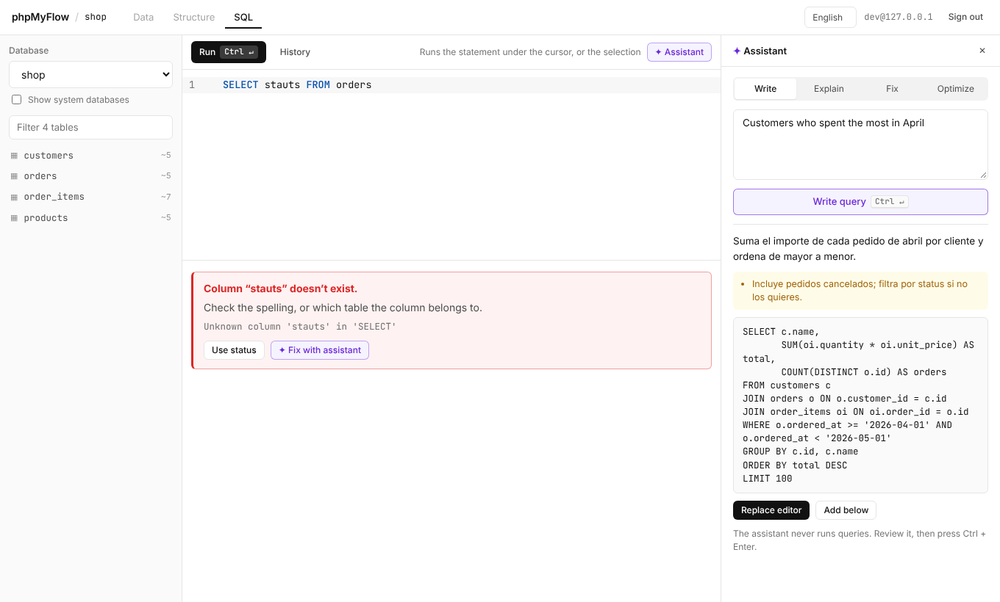

# phpMyFlow

**The modern replacement for phpMyAdmin.** Installs the same way, weighs less, and never reloads the page.

[English](README.md) · [Español](README.es.md)



phpMyFlow is a web admin for MySQL and MariaDB. Like phpMyAdmin, it's a folder of PHP files you upload to any host. Unlike phpMyAdmin, it's a single-page app with a real SQL editor and an assistant that writes queries against your actual schema.

> Status: early development (v0.1). Not ready for production data yet.

## What makes it different

- **No page reloads.** Browse tables, sort, filter and edit cells instantly.
- **An editor that knows your database.** Tables and columns autocomplete as you type, with their types and keys.
- **Mistakes caught before you run them.** Typos in table or column names are underlined live, with a one-click fix ("Did you mean `customers`?"). The server validates each statement with `EXPLAIN`, without executing it.
- **Errors in plain words.** MySQL error codes are explained in your language, with a suggestion when there is one.
- **Assistant (optional).** Describe what you need and get the query; explain, fix or optimize existing queries. It sees your schema and the execution plan, and never runs anything by itself. Works with Anthropic, OpenAI, OpenRouter or a local model through Ollama.
- **Safe by default.** One statement per request, confirmation before `DROP`, `TRUNCATE` or `UPDATE`/`DELETE` without `WHERE`, CSRF protection, login rate limiting, an allow-list of servers and an optional read-only mode.
- **English, Spanish, Italian and French**, light and dark themes.

## Install on a PHP host

Requirements: PHP 8.1+ with `pdo_mysql` and `openssl`. No Composer, no Node on the server.
Use PHP 8.3 or newer when you can: 8.1 no longer gets security fixes and 8.2 stops getting them at the end of 2026.

1. Download `phpmyflow-x.y.z.zip` from Releases and unzip it into your site, e.g. `public_html/phpmyflow/`.
2. Copy `config.sample.php` to `config.php` and set your database server(s).
3. Open `https://your-site/phpmyflow/` and sign in with a MySQL user.

Don't expose it to the whole internet if you can avoid it: restrict by IP, VPN or HTTP auth.

## Try it with Docker

```bash
docker compose up --build
# http://localhost:8080 — user root, password root
```

This starts MariaDB with a sample `shop` database.

## Enable the assistant

In `config.php`:

```php
'ai' => [
    'enabled' => true,
    'provider' => 'anthropic',      // or 'openai' for any OpenAI-compatible API
    'api_key' => 'sk-ant-…',
    'model' => 'claude-sonnet-5-5',
    'base_url' => '',               // e.g. http://localhost:11434/v1 for Ollama
],
```

The API key stays on the server. Your schema (table and column names, types, keys) is sent to the provider with each request; row data is not.

## Monitor

The **Monitor** tab shows how the MySQL/MariaDB server is working: live counters and charts, running processes (with KILL), the heaviest queries from `performance_schema`, storage, a diagnosis and the last deadlock. It uses your login by default; panels that need more privileges say which one and show the exact `GRANT`.

### Monitoring user (optional, needed for history)

Create a user with the minimum privileges:

```sql
CREATE USER 'phpmyflow_monitor'@'localhost' IDENTIFIED BY 'a long random password';
GRANT PROCESS, REPLICATION CLIENT ON *.* TO 'phpmyflow_monitor'@'localhost';
GRANT SELECT ON performance_schema.* TO 'phpmyflow_monitor'@'localhost';
-- optional: KILL other users' queries (MySQL 8: CONNECTION_ADMIN, MariaDB: SUPER or CONNECTION ADMIN)
-- optional: reset query statistics
GRANT DROP ON performance_schema.events_statements_summary_by_digest TO 'phpmyflow_monitor'@'localhost';
```

and add it to `config.php` (credentials only live there):

```php
'monitor' => ['host' => '127.0.0.1', 'port' => 3306, 'user' => 'phpmyflow_monitor', 'password' => '…'],
```

### History and peaks

`collect.php` takes one sample per minute: per-second rates, hourly database sizes and, when `threads_running`, queries/s or connections go over a threshold (fixed in `monitor_peaks`, or automatic: mean + 3σ of the last hour), a snapshot of the running statements (literals hidden) and the top 10 statement digests.

- **With cron** (preferred): `* * * * * php /path/to/phpmyflow/collect.php >/dev/null 2>&1`. The History panel shows this line with the real path.
- **Without cron**: set `'monitor_pseudo_cron' => true`. A sample is taken at most once a minute while someone has the Monitor open.

Data goes to `server/data/` (SQLite with `pdo_sqlite`, otherwise daily JSON Lines files). The folder gets `.htaccess` / `web.config` deny rules; better, move it out of the web root with `'monitor_data_dir' => '/var/lib/phpmyflow'`. Retention: 7 days at one-minute resolution, 90 days of hourly aggregates (min, avg, max, p95).

### Alerts

```php
'monitor_alerts' => [
    'thresholds' => ['threads_running' => ['warn' => 10, 'crit' => 30]],   // see Monitor::thresholds()
    'webhook' => 'https://hooks.slack.com/services/…',                    // optional
    'format' => 'slack',                                                   // slack | teams | generic
],
```

The Monitor tab shows a badge when a metric is over its threshold; the collector posts to the webhook at most once per metric every 15 minutes.

### performance_schema off (MariaDB default)

Heavy queries need `performance_schema = ON` in the server configuration (restart required). Until then the Monitor shows the slow query log status and how to enable it.

## Develop

```bash
# terminal 1: API
cd server && php -S 127.0.0.1:8080

# terminal 2: UI with hot reload (proxies api.php to :8080)
cd web && npm install && npm run dev
```

Load `docker/sample.sql` into a local MySQL/MariaDB to get the sample data. Build a release with `scripts/build-release.sh`.

## Roadmap

Done: insert rows, export (SQL, CSV, JSON, Excel) and SQL import in resumable steps, create and alter tables, views, routines, triggers and events, virtualized grid with keyboard navigation, editor tabs and dated history, server monitor.

Next:

- Command palette (Ctrl+K)
- Named saved queries and CSV import
- Two-factor login (TOTP)
- PostgreSQL driver

## Security

See [SECURITY.md](SECURITY.md) to report a vulnerability.

## License

[GNU AGPL-3.0](LICENSE). If you run a modified copy for other people, the AGPL asks you to offer them its source: set `source_url` in `config.php` (shown on the sign-in screen).
